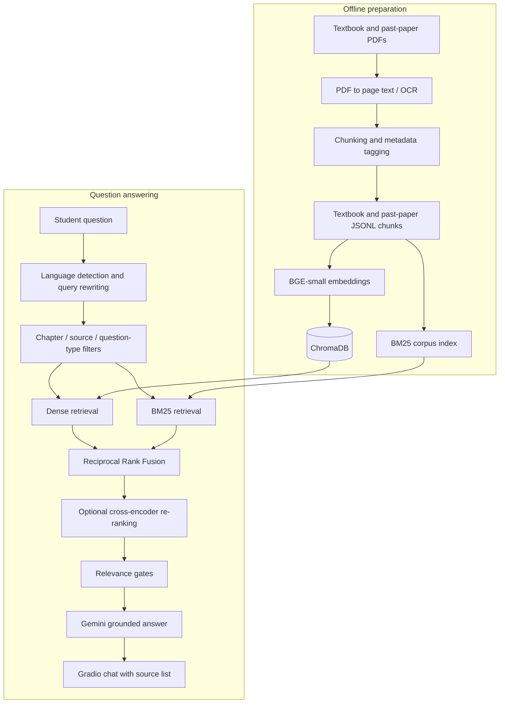

# Pak Edu RAG — Class 9 Physics Tutor (Lahore Board)

Pak Edu RAG is a retrieval-augmented study assistant for Class 9 Physics. It answers student questions using the Punjab Textbook Board textbook and Lahore Board past papers included in the project.

Students can ask questions in English or Roman Urdu/Hinglish. Answers are grounded in retrieved source material and include source references so students can trace the information.

## Features

- **Hybrid retrieval:** independent dense and BM25 retrieval, combined with Reciprocal Rank Fusion (RRF).
- **Cross-encoder re-ranking:** optionally re-ranks fused candidates to improve the ordering of relevant chunks.
- **Relevance gates:** filters weak retrieval results so unrelated questions can be refused instead of receiving unsupported answers.
- **Metadata filtering:** filter by chapter, source (textbook or past paper), and past-paper question type (MCQ, short, or long).
- **Query rewriting:** converts follow-up questions into standalone queries and translates Roman Urdu/Hinglish queries into English for retrieval.
- **Grounded responses:** factual explanations are restricted to retrieved sources and cite them as `[Source n]`.
- **MCQ handling:** identifies whether an answer is stated in the sources or solved by the tutor. Past papers do not include an answer key.
- **Important-question lookup:** identifies questions repeated across the available past papers. This is a frequency report, not a prediction of future exam questions.
- **Gradio interface:** interactive chat with chapter, source, and question-type filters.

## How it works



### Retrieval components

| Component | Implementation |
|---|---|
| Dense embeddings | `BAAI/bge-small-en-v1.5` through FastEmbed |
| Vector database | ChromaDB |
| Sparse retrieval | BM25 through `rank-bm25` |
| Fusion | Reciprocal Rank Fusion (RRF) |
| Re-ranking | Optional FastEmbed cross-encoder, default `Xenova/ms-marco-MiniLM-L-6-v2` |
| Answer generation and query rewriting | Google Gemini (`GEMINI_MODEL`, default `gemini-3.5-flash-lite`) |
| User interface | Gradio |

BM25 and dense retrieval operate independently. Their ranked results are fused using RRF; the re-ranker can then improve the ordering. If the re-ranker cannot load, retrieval is designed to fall back without it.

## Requirements

- Python 3.10 or newer recommended
- A Gemini API key for query rewriting and generated answers
- Internet access on first run to download embedding/re-ranking models
- Poppler utilities for the PDF-to-image/OCR preparation step

Install Poppler on Ubuntu/Debian:

```bash
sudo apt update
sudo apt install poppler-utils
```

## Setup

Run these commands from the project root:

```bash
python -m venv venv
source venv/bin/activate
pip install -r requirements.txt
cp .env.example .env
```

Add your Gemini API key to `.env`:

```env
GEMINI_API_KEY=your_api_key_here
```

Do not commit `.env` or expose your API key.

## Build the data and vector database

The repository contains OCR page text and generated data under `data/class_9/Lahore_board/physics/`. If you need to regenerate the data, run the preparation steps from the project root.

### 1. Convert PDF pages to text (if starting from PDFs)

Use `pdf_to_text.py` for the PDF-to-page-text preparation workflow. This step requires Poppler and the configured Gemini API access.

### 2. Create textbook chunks

```bash
python chunk_and_tag.py
```

This creates:

```text
data/class_9/Lahore_board/physics/textbook_chunks.jsonl
```

The textbook chunker uses word-based chunks with overlap and attaches class, subject, board, chapter, page, and source-type metadata.

### 3. Create and tag past-paper chunks

```bash
python chunk_past_papers.py
python tag_chapters_pastpapers.py
python fix_none_chapters.py
```

The past-paper workflow creates chunks, assigns chapter metadata, and retries chunks whose chapter could not initially be identified. The chapter-tagging steps use Gemini and therefore require a configured API key.

### 4. Build ChromaDB

```bash
python build_vectordb.py
```

This embeds the textbook and past-paper chunks and rebuilds the configured ChromaDB collection. The default collection name is `physics_class9` and the default database directory is `chroma_db`.

Re-run this step after changing the source chunks, chunking logic, or embedding model.

## Run the application

```bash
python app.py
```

Open the local Gradio interface:

```text
http://127.0.0.1:7860
```

The interface provides:

- **Chapter filter:** all chapters or a specific chapter.
- **Source filter:** textbook and past papers, textbook only, or past papers only.
- **Question-type filter:** all types, MCQs, short questions, or long questions.

Example questions:

- `What is Pascal's law?`
- `Pascal's law kya hai?`
- `Show me short questions from Chapter 4 past papers`
- `Explain Newton's first law in easy words`
- `Chapter 9 important short questions`

## Retrieval configuration

Retrieval settings are centralized in `config.py`. The current defaults include:

| Setting | Default | Purpose |
|---|---:|---|
| `MAX_DISTANCE` | `0.55` | Dense-distance gate for normal open questions |
| `RELAXED_MAX_DISTANCE` | `0.85` | More permissive dense gate for question-type/browse-style requests |
| `BM25_MIN_SCORE` | `6.0` | Minimum score for BM25-only retrieval |
| `BM25_SOLO_MIN_SCORE` | `6.0` | Minimum BM25 score for candidates found only by BM25 when re-ranking is enabled |
| `BM25_SOLO_MIN_SCORE_NO_RERANK` | `12.0` | Stricter BM25-only threshold when re-ranking is disabled or unavailable |
| `RERANK_MIN_SCORE` | `-8.6` | Default cross-encoder cutoff for the default re-ranker |
| `CANDIDATES` | `20` | Candidates retrieved from each retriever before fusion |
| `RRF_K` | `60` | RRF rank constant |
| `RERANK_CANDIDATES` | `15` | Fused candidates sent to the re-ranker |

The default re-ranker cutoff is specific to `Xenova/ms-marco-MiniLM-L-6-v2`. If `RERANK_MODEL` is changed, configure a suitable `RERANK_MIN_SCORE` or disable that cutoff; scores from different re-rankers are not directly interchangeable.

Useful environment overrides:

```env
GEMINI_API_KEY=your_api_key_here
GEMINI_MODEL=gemini-3.5-flash-lite
USE_RERANKER=1
RERANK_MODEL=Xenova/ms-marco-MiniLM-L-6-v2
RERANK_MIN_SCORE=-8.6
BM25_MIN_SCORE=6.0
BM25_SOLO_MIN_SCORE=6.0
BM25_SOLO_MIN_SCORE_NO_RERANK=12.0
```

## Evaluation

The retrieval evaluation compares six configurations:

1. BM25 only
2. Dense only
3. Previous hybrid approach (BM25 gated by dense retrieval)
4. RRF hybrid with BM25-only candidates requiring a score of at least 6
5. RRF hybrid without a re-ranker
6. RRF hybrid with the cross-encoder re-ranker

The evaluation reports Hit@1, Hit@5, Recall@5, MRR@5, nDCG@5, Precision@5, and false retrieval on out-of-scope questions. MRR@5 is reported with a 95% confidence interval.

### Results

All rows use the same dense-distance gate (`MAX_DISTANCE=0.55`). This makes the configurations directly comparable under the same gate; dense-only is lower than it would be with a looser gate.

The gates were tuned on the dev set. The held-out results were not used for tuning and are therefore the more reliable estimate of generalization.

#### Dev set — 66 answerable + 12 out-of-scope queries

| Configuration | Hit@1 | Hit@5 | Recall@5 | MRR@5 (95% CI) | nDCG@5 | P@5 | False retrieval |
|---|---:|---:|---:|---:|---:|---:|---:|
| BM25 only | 0.50 | 0.74 | 0.67 | 0.600 [0.50–0.70] | 0.630 | 0.17 | 0.42 (5/12) |
| Dense only | 0.30 | 0.55 | 0.43 | 0.399 [0.30–0.50] | 0.436 | 0.12 | 0.00 (0/12) |
| Hybrid (old: BM25 gated by dense) | 0.39 | 0.56 | 0.46 | 0.471 [0.36–0.57] | 0.487 | 0.12 | 0.00 (0/12) |
| Hybrid (RRF, BM25 solo ≥ 6) | 0.47 | 0.80 | 0.70 | 0.591 [0.49–0.68] | 0.639 | 0.18 | 0.42 (5/12) |
| Hybrid (RRF, no re-ranker) | 0.41 | 0.65 | 0.54 | 0.505 [0.39–0.61] | 0.535 | 0.14 | 0.00 (0/12) |
| Hybrid (RRF) + re-ranker | **0.56** | 0.73 | 0.64 | **0.639 [0.54–0.74]** | **0.657** | 0.17 | 0.17 (2/12) |

#### Held-out set — 34 answerable + 8 out-of-scope queries

This set was not used for tuning.

| Configuration | Hit@1 | Hit@5 | Recall@5 | MRR@5 (95% CI) | nDCG@5 | P@5 | False retrieval |
|---|---:|---:|---:|---:|---:|---:|---:|
| BM25 only | **0.62** | 0.76 | 0.75 | **0.673 [0.53–0.81]** | 0.691 | 0.18 | 0.12 (1/8) |
| Dense only | 0.24 | 0.47 | 0.40 | 0.318 [0.19–0.46] | 0.352 | 0.10 | 0.00 (0/8) |
| Hybrid (old: BM25 gated by dense) | 0.32 | 0.47 | 0.40 | 0.392 [0.25–0.55] | 0.410 | 0.10 | 0.00 (0/8) |
| Hybrid (RRF, BM25 solo ≥ 6) | 0.41 | 0.74 | 0.69 | 0.559 [0.43–0.70] | 0.598 | 0.17 | 0.12 (1/8) |
| Hybrid (RRF, no re-ranker) | 0.32 | 0.56 | 0.50 | 0.436 [0.29–0.58] | 0.464 | 0.13 | 0.00 (0/8) |
| Hybrid (RRF) + re-ranker | 0.53 | **0.82** | **0.79** | 0.659 [0.53–0.79] | **0.695** | **0.19** | 0.12 (1/8) |

### Results interpretation

- **The re-ranked hybrid is substantially stronger than dense-only retrieval.** On the held-out set, MRR@5 is 0.659 versus 0.318. Their reported 95% confidence intervals do not overlap.
- **The re-ranked hybrid also improves on the plain RRF hybrid.** Held-out MRR@5 is 0.659 versus 0.436 for RRF without re-ranking.
- **BM25 alone remains a strong ranking baseline.** Its held-out MRR@5 is 0.673, close to the re-ranked hybrid's 0.659; the confidence intervals overlap. The evaluation queries were written from textbook text, so lexical overlap is high.
- **The hybrid approach offers robustness beyond the ranking average**, especially for paraphrased queries and out-of-scope handling. On the dev set, the re-ranked hybrid reduces false retrieval from 5/12 for the BM25-solo-threshold RRF configuration to 2/12.
- **Interpret the metrics in light of the sample size.** There are 66 answerable dev queries and 34 answerable held-out queries. With one relevant chunk per query, P@5 cannot exceed 0.20.

The held-out results should be emphasized when reporting performance. Dev results are useful for understanding tuning behaviour, not as the primary estimate of expected performance.

## Important-question behaviour

Requests such as `Chapter 9 important short questions` are handled by `important.py` using the available past-paper data rather than an LLM-generated prediction.

Questions are grouped by textual similarity across papers and reported as:
- **Repeated:** found in more than one distinct paper.
- **Appeared once:** found in one paper in the available data.

The response identifies the papers in which a question appeared and explains the size of the available dataset. If there are too few questions for a selection, the system reports that the data is insufficient to judge. “Important” means repeated in the past papers available to this project; it does not mean that a question is guaranteed or predicted to appear in a future exam. Textbook exercise questions are not counted as past-paper evidence.

## Tests and diagnostics

Run the offline test suite:

```bash
pytest
```

Useful project scripts include:

```bash
python sanity_check.py
python test_retrieval.py
python eval_chapter_tags.py sample --n 60
python eval_chapter_tags.py score
```

`eval_chapter_tags.py sample` creates a CSV sample for manual chapter-label verification. Fill in the `true_chapter` column and run the `score` command to calculate accuracy and per-chapter precision, recall, and F1.

The retrieval evaluation script supports configuration ablations and can write diagnostics for missed queries. Check its command-line help for the options available in the current checkout:

```bash
python eval_retrieval.py --help
```

## Project structure

```text
Pak_Edu_RAG/
├── app.py                     # Gradio chat interface and filters
├── qa.py                      # Language handling, query rewrite, prompt, answer pipeline
├── config.py                  # Paths, model names, retrieval thresholds, Gemini config
├── hybrid_search.py            # Dense + BM25 retrieval, RRF, optional re-ranking and gates
├── important.py                # Past-paper frequency-based important-question route
├── pdf_to_text.py              # PDF page extraction / OCR preparation
├── chunk_and_tag.py            # Textbook chunking and metadata
├── chunk_past_papers.py        # Past-paper chunking
├── tag_chapters_pastpapers.py  # Past-paper chapter tagging
├── fix_none_chapters.py        # Retry missing chapter tags
├── build_vectordb.py           # Build ChromaDB embeddings
├── eval_retrieval.py           # Retrieval ablation and metrics
├── eval_sweep.py               # Relevance-threshold tuning
├── eval_generation.py          # Generation evaluation
├── eval_chapter_tags.py        # Manual chapter-tag accuracy evaluation
├── sanity_check.py             # Chunk and metadata checks
├── test_retrieval.py           # Manual dense-retrieval inspection helper
├── tests/                      # Automated tests
├── data/                       # OCR text and generated chunks
├── eval/                       # Evaluation datasets and outputs
└── chroma_db/                  # Persistent vector database
```

## Known limitations

- The embedding model is English-oriented; Roman Urdu/Hinglish retrieval depends on the Gemini query-rewriting/translation step.
- Chunks are created from individual textbook pages, so content spanning page boundaries may be split.
- Past-paper MCQs do not have an answer key in the supplied data. When the source does not state the answer, the tutor may solve the MCQ and labels it as tutor-solved rather than source-provided.
- “Important questions” are based only on repetition in the past papers present in the dataset; they are not exam predictions.
- The evaluation sets are relatively small. Results should be treated as evidence about this dataset, not as a guarantee of performance on every board, subject, or question style.

